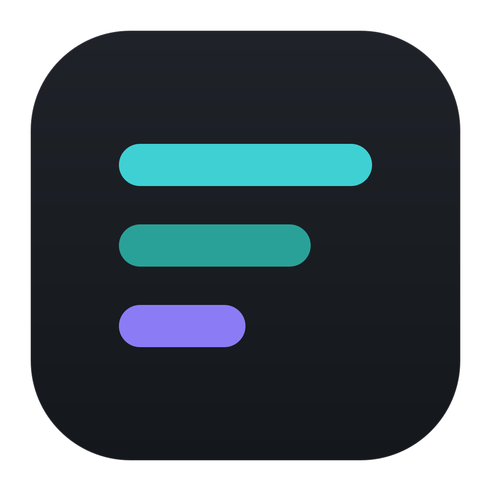
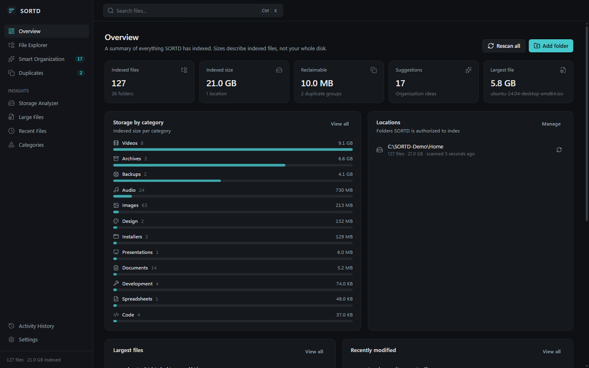
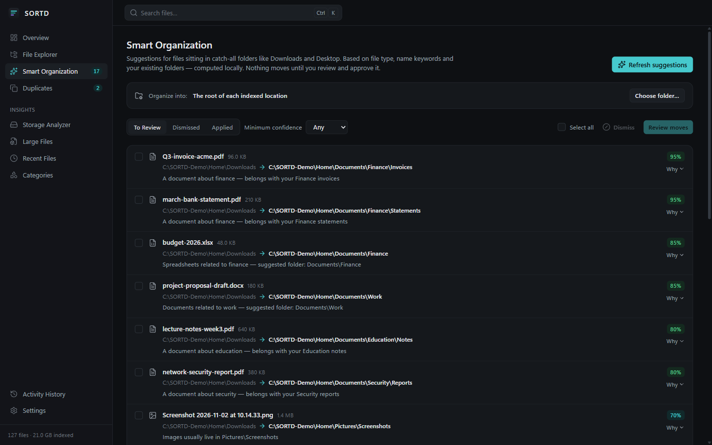
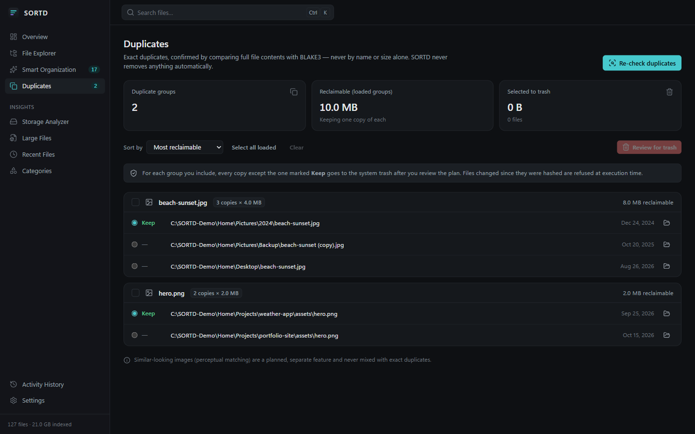
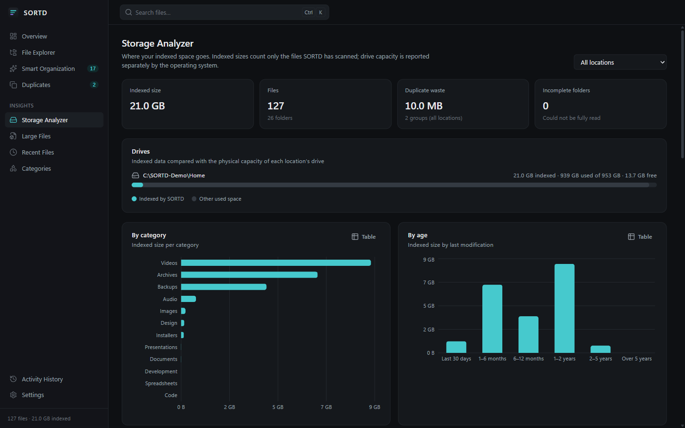
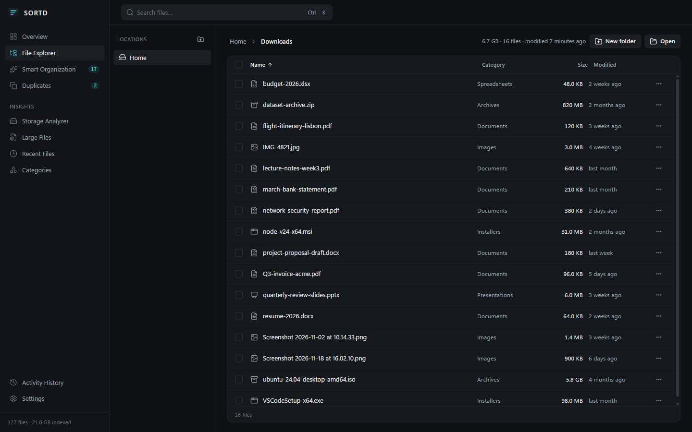
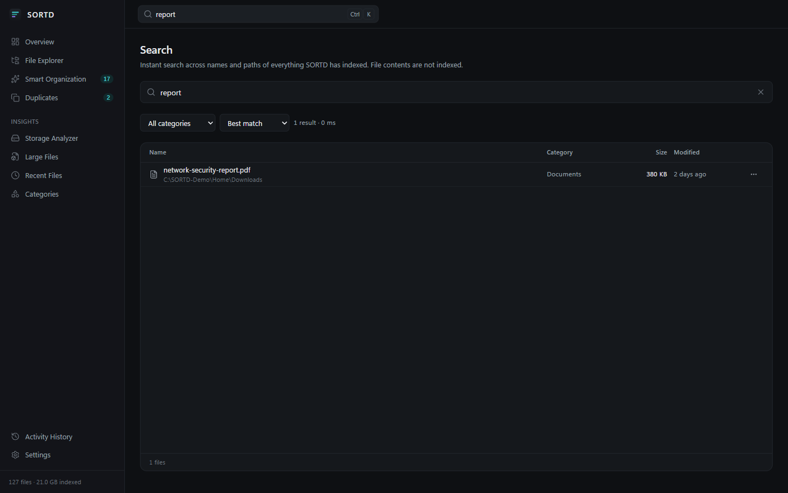
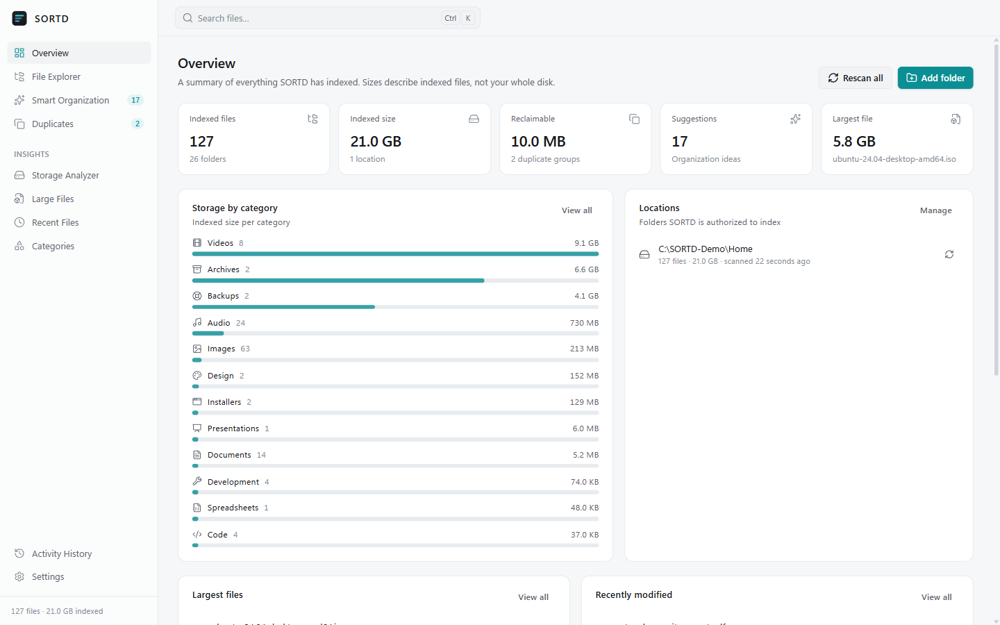

<p align="center">
  
</p>

<h1 align="center">SORTD</h1>

<p align="center"><strong>Your files. Finally under control.</strong></p>

<p align="center">
A local-first desktop app for understanding, searching, organizing and reclaiming your storage —
on Windows, macOS and Linux. No account, no cloud, no telemetry.
</p>

---

## What SORTD does

SORTD indexes the folders you choose and turns them into something you can actually reason about:

- **Overview** — real statistics from your index: file counts, indexed size, category breakdown, largest and most recent files, scan history.
- **File Explorer** — browse indexed folders with recursive sizes; folders that couldn't be fully read are marked, and their sizes shown as lower bounds.
- **Smart Organization** — transparent, rule-based suggestions for files sitting in Downloads, Desktop and similar catch-all folders (e.g. `network-security-report.pdf` → `Documents/Security/Reports`), each with the signals and confidence behind it. Uses your existing folders when they match. Runs entirely locally.
- **Duplicates** — exact duplicate detection: size grouping → sampled partial hash → full **BLAKE3** verification. Never by name or size alone. You choose which copy to keep.
- **Storage Analyzer** — space by category, age and extension, largest folders and files, and indexed data shown alongside (never conflated with) physical drive capacity.
- **Large Files / Recent Files / Categories** — filterable, sortable, virtualized lists that stay fast with hundreds of thousands of files.
- **Search** — instant substring search (SQLite FTS5 trigram index) with filters and a small query language: `ext:pdf`, `cat:images`, `size>100mb`, `newer:7d`, `in:path`, `"exact phrase"`.
- **Safe file operations** — move, rename, copy, create folder and move-to-trash. Every change is previewed first, can be dry-run, never overwrites anything, is verified after it runs, is recorded in a journal, and can be undone where possible.
- **Activity History** — a local log of scans, previews and every file operation, with undo.

## Safety model

SORTD is designed to be trusted with personal files:

| Guarantee | How |
|---|---|
| Nothing changes during scanning or analysis | Scanner, duplicate detection and suggestions are read-only. |
| Nothing changes without your approval | Every operation is planned, shown in a preview, and executed only on explicit confirmation. |
| No silent overwrites | Renames use the platform's *no-replace* primitive (`MoveFileExW` without `REPLACE_EXISTING`, `renameat2(RENAME_NOREPLACE)`, `renamex_np(RENAME_EXCL)`). Conflicts are skipped or renamed — your choice. |
| No partial files | Copies stream into a hidden temp file, are BLAKE3-verified against the source, and only then renamed into place. |
| Cross-drive moves are deliberate | Disabled unless you opt in per operation; the original is removed only after a verified copy. |
| Stale previews can't do damage | Each item is re-validated immediately before it runs (authorization, symlinks, size/mtime snapshot, destination still free). |
| Crashes are recoverable | Items are journaled *before* execution; on restart SORTD reconciles anything that was in flight. |
| No permanent deletion | "Delete" always means the system trash. |
| Files are never executed | Programs, scripts, installers and links are never "opened"; content inspection reads at most 8 KB. |

Filesystem operations are **not** transactional and SORTD does not pretend otherwise: the journal records exactly what happened to each item. See [SECURITY.md](SECURITY.md) for the full threat model.

## Humans stay in control

SORTD deliberately has **no AI agent or MCP access** to your files. An app that can move and trash things should be
operated by the person who owns them: every change is something you looked at in a preview and approved. Future
"intelligence" features (local classification, semantic search) will only ever *suggest*; they will never act.

## Privacy

- No account, no telemetry, no analytics, no network requests.
- File names, paths and contents never leave your computer.
- The index (a SQLite database) stores metadata only — never file contents.
- Search history is optional, local, and erased when you turn it off.

## Screenshots

<p align="center">
  
</p>

| Smart Organization | Duplicates |
|---|---|
|  |  |
| **Storage Analyzer** | **File Explorer** |
|  |  |
| **Search** | **Light theme** |
|  |  |

<sub>Captured from the running app (Windows 11) indexing a generated sample folder, so no personal files are shown.
More: [Large Files](docs/screenshots/large-files.png) · [Categories](docs/screenshots/categories.png) · [Settings](docs/screenshots/settings.png) · [Storage (light)](docs/screenshots/storage-light.png).</sub>

## Installation

Download the installer for your system from the [Releases page](https://github.com/eezy18x/sortd/releases):

| System | File | Notes |
|---|---|---|
| Windows 10/11 (x64) | `SORTD_x.y.z_x64-setup.exe` (recommended) or `SORTD_x.y.z_x64_en-US.msi` | The setup `.exe` installs for your user account without admin rights. |
| macOS Apple Silicon | `SORTD_x.y.z_aarch64.dmg` | Open the DMG and drag SORTD to Applications. |
| macOS Intel | `SORTD_x.y.z_x64.dmg` | Same as above. |
| Linux (Debian/Ubuntu) | `sortd_x.y.z_amd64.deb` | `sudo apt install ./sortd_x.y.z_amd64.deb` |
| Linux (Fedora/openSUSE) | `sortd-x.y.z-1.x86_64.rpm` | `sudo dnf install ./sortd-x.y.z-1.x86_64.rpm` |
| Linux (any distro) | `SORTD_x.y.z_amd64.AppImage` | `chmod +x` it, then run it. |

**About security warnings:** early releases are not code-signed with paid certificates yet, so your OS will warn you
the first time:

- **Windows** — SmartScreen shows "Windows protected your PC": choose *More info → Run anyway*.
- **macOS** — builds are ad-hoc signed but not notarized. If macOS refuses to open SORTD, right-click the app →
  *Open*, or run `xattr -dr com.apple.quarantine /Applications/SORTD.app` once.

Prefer to build it yourself? See [docs/DEVELOPMENT.md](docs/DEVELOPMENT.md).

## Platform support

| Platform | Status |
|---|---|
| Windows 10/11 x64 | Developed and tested locally |
| macOS (Apple Silicon, Intel) | Built and unit-tested in CI |
| Linux x64 (Ubuntu/Debian, Fedora, Arch-compatible) | Built and unit-tested in CI |

Details and platform-specific behaviour: [docs/PLATFORM_SUPPORT.md](docs/PLATFORM_SUPPORT.md).

## Development

```bash
pnpm install
pnpm tauri dev        # run the app
pnpm test             # frontend tests
cd src-tauri && cargo test   # backend tests
```

Prerequisites per OS, project layout and conventions: [docs/DEVELOPMENT.md](docs/DEVELOPMENT.md).

## Architecture

Tauri 2 shell · Rust core (SQLite/rusqlite, BLAKE3, walkdir) · React + TypeScript + Tailwind CSS frontend.
All OS-specific behaviour is isolated in one Rust module behind a common interface; the frontend never touches the
filesystem directly and can only call an explicit allowlist of backend commands.
See [docs/ARCHITECTURE.md](docs/ARCHITECTURE.md).

## Roadmap

- Filesystem watching for live index updates
- User-defined organization rules
- Similar-image detection (perceptual hashing, kept separate from exact duplicates)
- Optional local AI classification and semantic search (on-device only)
- OCR for images and PDFs, optional full-content indexing
- Browser downloads integration and optional cloud-drive connectors
- Plugin system

## Contributing

Contributions are welcome — please read [CONTRIBUTING.md](CONTRIBUTING.md) first. Security issues: see [SECURITY.md](SECURITY.md).

## License

[MIT](LICENSE) © muffle
